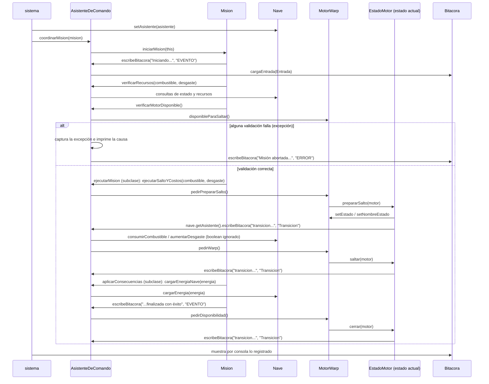

# Asistente de Navegación y Comando — Software Embarcado de una Nave Interestelar

**Trabajo Práctico Grupal 2026 · Programación C · Entrega 1**
**Etiqueta Git:** `entrega-e1` · **Fecha de entrega:** 15/10/2026

|                   |            |
|-------------------|------------|
| **Grupo**         | `SENIT_G5` |
| **Integrantes** | GitHub |
| Mc Kesey Juan | https://github.com/juanmaki |
| Iasillo Amelie | https://github.com/Lesnikns |
| Elizalde Facundo  | https://github.com/FacuElizalde29 |
| Escobar Peñalva Ramiro Nahuel | https://github.com/ramiropnlv |
| **Repositorio**   | [senit_g5](https://github.com/Lesnikns/TPG-Nave-Interestelar-Tripulada) |

---

## Índice

1. Introducción
2. Arquitectura general
3. Modelo de dominio y responsabilidades
4. Patrones de diseño aplicados
5. Contratos, invariantes y manejo de errores
6. Decisiones de diseño
7. Evidencias funcionales
8. Trazabilidad con los requerimientos

---

## 1. Introducción

### 1.1 Contexto

En un futuro en el que las naves interestelares operan durante períodos prolongados y lejos de sus bases, la comunicación no siempre es inmediata. Cada nave cuenta entonces con una tripulación comandada por un/a capitán/a y con un **software embarcado** que la asiste en la preparación, ejecución y evaluación de sus misiones.

Este proyecto es ese software: un **asistente de navegación y comando**. El asistente **no reemplaza al capitán ni controla libremente la nave**: opera dentro de reglas y autorizaciones explícitas, coordina subsistemas, controla el consumo de recursos y deja registro de todo lo relevante.

### 1.2 De qué consta el proyecto

El trabajo se desarrolla en dos entregas incrementales sobre **un único proyecto**:

- **Entrega 1 (este documento):** el núcleo orientado a objetos, en un entorno controlado y sin universo dinámico.
- **Entrega 2:** integración con el Motor de Simulación provisto por la cátedra (tablero, sensores, eventos, navegación por reglas, persistencia, concurrencia e interfaz Swing/MVC).

Por eso, el diseño de la Entrega 1 se pensó para **crecer sin reescribirse**: el dominio no depende de consola ni de Swing, de modo que en E2 los mismos objetos podrán conectarse a vistas y controladores. Esa separación hoy **no es total**: ver 2.2 y 2.5.

### 1.3 Alcance de la Entrega 1

**Incluye** (requerimientos E1-01 a E1-10):

| Req. | Qué se construyó | Cumplimiento |
|---|---|---|
| E1-01 | Modelo de nave con identidad, tipo, componentes y recursos (exploradora, carguero, combate) | `salida-E1.txt`: Escenario A, pasos 1 (configuración inicial de las tres naves) y 4 (recursos finales) |
| E1-02 | Motor Warp con estados Disponible, Preparando salto, En warp y Enfriamiento (**State**) | `salida-E1.txt`: Escenario C (transiciones válidas e inválidas; sin Enfriamiento) |
| E1-03 | Asistente de Comando que recibe órdenes, coordina, maneja errores y registra resultados | `salida-E1.txt`: Escenarios A y B (coordinación, captura de errores y registro) |
| E1-04 | Tripulación: identidad, cargo, planeta de origen y antigüedad | `salida-E1.txt`: Escenario A, paso 2, y sección Haberes |
| E1-05 | Bitácora de eventos consultable en orden temporal | `salida-E1.txt`: Bitácora de los escenarios A, B y C |
| E1-06 | Misiones M-01, M-02 y M-03 simplificadas con ciclo común (**Template Method**) | `salida-E1.txt`: Escenario A, paso 3 (M-01, M-02 y M-03) |
| E1-07 | Creación de naves mediante una fábrica (**Factory**) | `salida-E1.txt`: Escenario A, paso 1 |
| E1-08 | Liquidación mensual de haberes por composición de conceptos (**Decorator**) | `salida-E1.txt`: Sección Haberes (4 cargos × 3 orígenes y liquidación) |
| E1-09 | Recursos (combustible, energía, desgaste) y mantenimiento | `salida-E1.txt`: Secciones Mantenimiento y Escenario D, y recursos del Escenario A |
| E1-10 | Informe mínimo de misión | `salida-E1.txt`: Bitácora del Escenario A (no hay informe propio) |

**No incluye** (corresponde a E2): biblioteca del universo, tablero, sensores reales, eventos externos dinámicos, interacción con otras naves, concurrencia, persistencia JDBC e interfaz gráfica MVC.

### 1.4 Las tres misiones

Todas siguen el ciclo **preparar → ejecutar → evaluar → cerrar** y consumen por su operación controlada 4 unidades de combustible y 4 de desgaste.

| Misión | Acción simplificada | Energía adicional |
|---|---|---|
| M-01 Intercepción y asistencia | Llegar al objetivo simulado y realizar la asistencia | 5 |
| M-02 Recolección | Llegar al punto simulado y obtener datos o muestra | 5 |
| M-03 Retorno seguro | Completar el regreso simulado | 0 |

### 1.5 Tecnologías y herramientas

- **Lenguaje:** Java 25 (`release 25` del compilador de Maven)
- **Construcción:** Maven (estructura estándar)
- **Control de versiones:** Git/GitHub, con etiqueta `entrega-e1`
- **IDE:** `IntelliJ IDEA / JDeveloper`
- **Pruebas / demostración:** clase main de demostración `Sistema`, con comprobaciones `[OK]`/`[FALLO]` por escenario
- **Bibliotecas adicionales:** `COMPLETAR: ninguna / listar y justificar`

### 1.6 Organización de la documentación del repositorio

| Archivo | Contenido |
|---|---|
| `../../../../Downloads/README.md` | Requisitos, comandos Maven, cómo iniciar, cómo verificar, configuración local y etiqueta |
| `pom.xml` | Proyecto Maven reproducible |
| `.gitignore` | Excluye archivos generados, binarios y datos locales |
| `.mvn/jvm.config` | Fuerza UTF-8 en la JVM de Maven para que la salida muestre bien los acentos en Windows |
| `docs/diseno-E1.md` | Este documento |
| `docs/diagrama-clases.*` | Diagrama de clases consistente con el código |
| `docs/evidencias/` | Salidas de ejecución y/o reportes de pruebas |
| `docs/uso-ia.md` | Registro del uso de inteligencia artificial |

---

## 2. Arquitectura general

El proyecto simula la operación de una nave espacial. Una **Nave** (de combate, exploradora o carguera, creada por una fábrica) incorpora un **MotorWarp**, modelado como máquina de estados, y una **tripulación** cuyos miembros combinan un origen (vulcano, marciano o terrícola) con un cargo (capitán, consejero, teniente o alférez), resuelto mediante *decorators*. El **Asistente de Comando** recibe las órdenes, coordina la ejecución de las **misiones** (definidas a partir de una plantilla común) y deja constancia de cada evento en la **Bitácora**. La clase `Sistema` arma los objetos, ejecuta las misiones y muestra por consola lo que registró la Bitácora.

Los patrones de diseño utilizados son:

| Patrón | Dónde se aplica |
|---|---|
| Factory | `FabricaDeNaves` crea las naves según su tipo |
| State | `MotorWarp` (contexto) delega en `EstadoMotor`; los estados concretos deciden las transiciones válidas y cambian el estado del motor |
| Decorator | `Tripulante` / `Persona` / `CargoDecorator`: el origen lo aporta `Persona`, el cargo el decorador, y el sueldo suma el aporte del cargo al de la persona. Un tripulante admite un solo cargo: `CargoDecorator` exige que el envuelto devuelva `"Sin cargo"` (valor que define `Persona`), verificado con `assert` en uno de los dos constructores (solo actúa si la JVM se ejecuta con `-ea`). **Límite:** hay una sola capa de decorador, sin composición de dos o más decoradores (ver 2.5) |
| Template Method | `Mision.iniciarMision` (`final`) define el esqueleto; cada misión concreta implementa sus pasos variables |

La separación entre dominio y presentación es parcial (ver 2.2). El diseño tiene **incumplimientos conocidos respecto del enunciado** y varias decisiones cuestionables, todos documentados en 2.5. Los más relevantes: el estado Enfriamiento no se recorre, no existe un informe propio por misión, hay salida por consola dentro del dominio y el Decorator tiene una sola capa. Además, el acoplamiento entre los estados del motor y el Asistente y la gestión de la tripulación dentro de `Nave` son decisiones de diseño cuestionables.

### 2.1 Estructura de paquetes

```
src/main/java/.../
├── Asistente/          AsistenteDeComando, Bitacora, Entrada, Mision (template)
│                       y las misiones concretas (M-01, M-02, M-03)
├── Excepciones/        NaveNoOperativaException, CombustibleInsuficienteException,
│                       DesgasteCriticoException, MotorNoDisponibleException,
│                       ConfiguracionInicialInvalidaException,
│                       TipoDeNaveInvalidoException
├── Motor/              MotorWarp, EstadoMotor y sus estados concretos
│                       (Disponible, PreparandoSalto, EnWarp, Enfriamiento)
├── Naves/              Nave (abstracta), NaveDeCombate, NaveExploradora,
│                       NaveCarguero, FabricaDeNaves
├── Tripulacion/        Tripulante, Persona (Vulcano, Marciano, Terricola),
│                       CargoDecorator (Capitan, Consejero, Teniente, Alferez)
└── Sistema.java        Clase main de demostración (paquete por defecto)
```

Correspondencia de misiones (el código `M-0X` de los mensajes de `Mision` se arma a partir del atributo `id`):

| Código | Clase |
|---|---|
| M-01 | `MisionIntercepcionAsistencia` |
| M-02 | `MisionRecoleccion` |
| M-03 | `MisionRetornoSeguro` |

### 2.2 Separación dominio / presentación

El enunciado (E1-03 y Observaciones) exige que las clases del núcleo no dependan de `Scanner`, `System.out`, `JOptionPane` ni `JFrame`, y que solo el `main` de demostración use consola. Las clases del modelo (`Nave` y sus tipos, `MotorWarp`, `EstadoMotor` y los estados concretos, `Tripulante` y sus decoradores) cumplen: informan únicamente mediante valores de retorno, excepciones y la Bitácora.

La separación **no es total, y en esos puntos el diseño no cumple E1-03**. Las clases `Mision` (en `prepararMision` y `finalizarMision`), las tres misiones concretas (en `ejecutarMision`) y `AsistenteDeComando` (únicamente en los `catch` de `coordinarMision`) imprimen mensajes de progreso y de error con `System.out.println`, además de registrar el mismo evento en la Bitácora. Por eso `Sistema` no es la única clase que escribe por consola, aunque sí la que muestra el contenido de la Bitácora. Se documenta en 2.5.

Las operaciones de `Nave` devuelven `boolean` y las situaciones anómalas de una misión se comunican mediante excepciones específicas, por lo que quien invoca decide cómo reaccionar.

**Incumplimiento conocido:** el enunciado (sección 7) pide que las consultas del modelo devuelvan datos utilizables por distintos clientes, sin formatearlos para consola. `Bitacora.toString()` devuelve el historial completo como texto ya formateado (una línea por `Entrada`, con fecha, tipo y mensaje), y es lo que `Sistema` muestra por consola. `Bitacora.getEntradas()` devuelve la lista de objetos, pero es `protected` y no es accesible para `Sistema`, por lo que un cliente distinto (por ejemplo, una vista Swing en E2) no puede consumir los datos sin parsear texto.

### 2.3 Flujo general de una orden

Cuando `Sistema` ordena ejecutar una misión:

1. `Sistema` obtiene una nave de `FabricaDeNaves.getNave(tipo)` (lanza `TipoDeNaveInvalidoException` si el tipo no existe), construye el `AsistenteDeComando(nave)` y se lo asigna a la nave con `Nave.setAsistente`.
2. `Sistema` invoca `AsistenteDeComando.coordinarMision(mision)`.
3. El Asistente llama a `mision.iniciarMision(this)`, método plantilla `final` que ejecuta los cuatro pasos en orden.
4. **`prepararMision` (validación):** imprime el inicio, lo registra en la Bitácora (tipo `EVENTO`) y pide al Asistente:
   - `verificarRecursos(combustible, desgaste)`: lanza `NaveNoOperativaException` si la nave no está operativa, `CombustibleInsuficienteException` si el combustible es menor al requerido y `DesgasteCriticoException` si el desgaste resultante superaría 100.
   - `verificarMotorDisponible()`: lanza `MotorNoDisponibleException` si el motor no está en `Disponible`.

   Ambas son consultas: si fallan, se aborta sin modificar la nave.
5. **`ejecutarMision` (implementada por cada misión):** registra el inicio de la acción específica y ordena al Asistente `ejecutarSaltoYCostos(combustible, desgaste)`, que en este orden:
   1. pide `pedirPrepararSalto()` al motor,
   2. descuenta el combustible (`consumirCombustible`),
   3. suma el desgaste (`aumentarDesgaste`),
   4. pide `pedirWarp()` al motor.

   Cada pedido al motor se delega en su estado actual, que cambia el estado y registra una entrada de tipo `Transicion` (o `Error` si la transición no es válida). El Asistente no evalúa los `boolean` de `consumirCombustible` y `aumentarDesgaste`, porque los recursos ya fueron validados en el paso 4. `MisionRecoleccion` registra además el resultado de la recolección.
6. **`aplicarConsecuencias` (implementada por cada misión; es el paso "evaluar" del ciclo):** ordena al Asistente `cargarEnergiaNave(energia)` y registra el resultado (la bonificación la define cada misión: +5 en `MisionRecoleccion` y `MisionIntercepcionAsistencia`, ninguna en `MisionRetornoSeguro`). Si la energía resultante superara el máximo, `Nave.cargarEnergia` la rechaza sin modificar la nave; el Asistente no lo evalúa, así que la misión registra la bonificación igualmente. Con la configuración inicial, una nave de Combate (energía 100) siempre rechaza el +5 (ver 2.5). Este paso **no verifica la condición de éxito** de cada misión que define la Ficha de Inicio (ver 2.5).
7. **`finalizarMision` (privado):** registra el cierre exitoso en la Bitácora e imprime un mensaje. No genera un informe propio de la misión (ver 2.5).
8. De vuelta en `coordinarMision`, se llama a `nave.getMotor().pedirDisponibilidad()`, que delega en `EstadoMotor.cerrar`: el motor pasa de `EnWarp` a `Disponible` y se registra la transición. Este paso es un atajo provisorio que **saltea el estado `Enfriamiento`** (ver 2.5).
9. Si en cualquier paso se lanza una de las cuatro excepciones (`NaveNoOperativaException`, `CombustibleInsuficienteException`, `DesgasteCriticoException`, `MotorNoDisponibleException`), `coordinarMision` la captura, imprime la causa y registra en la Bitácora una entrada de tipo `ERROR` ("Misión abortada"). Un `catch (Exception)` final actúa como red de seguridad y solo imprime por consola, sin registrar en la Bitácora.
10. Al terminar, `Sistema` obtiene la Bitácora con `AsistenteDeComando.getBitacora()` y muestra por consola lo que registró.



**Máquina de estados del motor.** Cada estado decide qué transiciones son válidas:

| Estado actual | Acción | Resultado |
|---|---|---|
| Disponible | `prepararSalto` | → PreparandoSalto |
| PreparandoSalto | `saltar` | → EnWarp |
| EnWarp | `cerrar` | → Disponible (atajo provisorio: todavía no se modela el paso del tiempo; saltea Enfriamiento) |
| EnWarp | `enfriar` | → Enfriamiento **(pendiente: hoy no tiene efecto y no registra)** |
| Enfriamiento | (pasa el tiempo) | → Disponible **(pendiente: el estado existe pero no se alcanza)** |
| cualquiera | otra acción | sin efecto sobre la nave; se registra un evento de tipo `Error` en la Bitácora |

La secuencia que exigen E1-02 y el Escenario C de la Ficha de Inicio (`Disponible → Preparando salto → En warp → Enfriamiento → Disponible`) **no se cumple todavía**: el flujo actual va de `EnWarp` directo a `Disponible`. Los nombres de estado que se muestran y registran son los de `EstadoMotor.nomEstados`: "Disponible", "Preparando salto ", "Salto warp" y "Enfriamiento". Cada transición válida se registra como evento de tipo `Transicion`.

**Dos variantes de registro.** Los recursos de la nave se validan antes con consultas del Asistente, y el costo se aplica sin evaluar el resultado; los eventos de la misión los registran la misión y el Asistente. Las transiciones del motor, en cambio, las registra cada estado por su cuenta, llamando a `Nave.getAsistente()`. Ver 2.5.

**Liquidación de haberes (orden independiente).** `Sistema` invoca `AsistenteDeComando.liquidarHaberesMensuales()`. El Asistente recorre `nave.getTripulacion()`, pide a cada `Tripulante` su `getSueldo()` (el decorador suma el aporte del cargo al sueldo de la persona) y registra una entrada de tipo `LIQUIDACION` por tripulante y otra con el total. No modifica la tripulación ni la nave. El resultado no desglosa el aporte de cada concepto (ver 2.5).

### 2.4 Diagrama de clases


[Ver en tamaño completo](diagrama-clases.png) · Fuente editable: [`diagrama-clases.puml`](diagrama-clases.puml)

- Verificado contra: commit `[COMPLETAR hash]`, fecha 2026-10-11.
- Las flechas rojas punteadas marcan el acoplamiento no deseado descripto en 2.5.
- Los estados concretos del motor guardan una referencia a `Nave`; no se dibuja cada línea para no saturar el diagrama.
- Se omiten las clases del paquete `Excepciones`, los getters y setters de `Mision` y los getters de `Nave`.

## 3. Modelo de dominio y responsabilidades

La columna "Qué NO hace" describe lo que la clase efectivamente no hace en el código. Donde el diseño se desvía de lo esperado, se indica con una referencia a 2.5.

| Clase / interfaz | Responsabilidad | Colabora con | Qué NO hace |
|---|---|---|---|
| `Nave` (abstracta) | Representa la nave y es dueña de su estado. **Identidad:** `id` autoincremental y `tipo`. **Recursos:** combustible, energía y desgaste (0 a 100); cada operación (`cargar*`, `consumir*`, `aumentarDesgaste`) devuelve `boolean`. **Mantenimiento:** requiere mantenimiento con desgaste ≥ 80 (umbral) y entonces deja de estar operativa; `realizarMantenimiento` lo lleva a 0. **Tripulación:** asignar y eliminar (sin nulos ni repetidos) y verificar la mínima (un Capitán y al menos 5 tripulantes). Crea su `MotorWarp` y valida los valores iniciales en el constructor (`ConfiguracionInicialInvalidaException`) | `MotorWarp`, `Tripulante`, `AsistenteDeComando` (solo guarda la referencia), `ConfiguracionInicialInvalidaException` | No registra en la Bitácora ni imprime. No decide misiones ni valida operaciones: informa éxito o fracaso y quien invoca decide. Si una carga superaría el tope, rechaza la operación completa (como pide la Ficha de Inicio) y no la limita. La gestión de la tripulación debería estar en una clase aparte (ver 2.5) |
| `NaveDeCombate`, `NaveExploradora`, `NaveCarguero` | Especializaciones de `Nave` que fijan su tipo (`"combate"`, `"exploradora"`, `"carguero"`) y sus valores iniciales de recursos (ver sección 4.2) mediante constantes y el constructor de `Nave`. Se diferencian solo por esos datos | `Nave` (superclase), `FabricaDeNaves` (las crea) | No agregan comportamiento propio: solo constantes y constructor. No reciben parámetros: los valores iniciales son fijos |
| `FabricaDeNaves` | Patrón Factory: crea la nave según el tipo pedido (`"carguero"`, `"combate"`, `"exploradora"`). Lanza `TipoDeNaveInvalidoException` si el tipo no existe | `Nave` y sus tres tipos, `TipoDeNaveInvalidoException` | No asigna el Asistente ni la tripulación (lo hace `Sistema`). No guarda las naves que crea. Elige el tipo por `String`, sin validación en compilación (ver 2.5) |
| `MotorWarp` | Contexto del patrón State: guarda el estado actual y su nombre, delega cada pedido (`pedirPrepararSalto`, `pedirWarp`, `pedirDisponibilidad`, `pedirEnfriamiento`) en el estado y responde si está disponible para saltar | `EstadoMotor` y sus estados concretos | No decide transiciones, no registra eventos, no conoce al Asistente ni a la Bitácora y no consume recursos. Guarda la `Nave` pero solo la usa para crear el primer estado |
| `EstadoMotor` y estados (`Disponible`, `PreparandoSalto`, `EnWarp`, `Enfriamiento`) | Deciden qué transiciones son válidas, cambian el estado del motor y registran cada transición válida (`Transicion`) o rechazada (`Error`) | `MotorWarp`, `Nave`, `AsistenteDeComando` | No consumen recursos. **Registran en la Bitácora a través de `Nave.getAsistente()`, algo que no les correspondería (ver 2.5)**. `Enfriamiento` existe pero la secuencia no lo alcanza: el cierre pasa de `EnWarp` a `Disponible` (ver 2.5) |
| `Tripulante` / `Persona` | `Tripulante` es el contrato: nombre, origen, sueldo, descripción y cargo. `Persona` es la base abstracta de los tripulantes sin cargo (`Vulcano`, `Marciano`, `Terricola`): guarda el nombre, devuelve `"Sin cargo"` como cargo, arma la descripción (origen y nombre) y deja abstractos el origen y el sueldo base, que fija cada subclase: `Vulcano` 30, `Marciano` 18 y `Terricola` 20 | `CargoDecorator`, `Nave` (la contiene), `AsistenteDeComando` (consulta el sueldo) | No sabe a qué nave pertenece. No tiene cargo propio ni antigüedad (los aporta el decorador); una `Persona` sin envolver no cumple E1-04. No valida la tripulación mínima (lo hace `Nave`) ni liquida (lo hace el Asistente). Valida el nombre solo con `assert` |
| `CargoDecorator` (`Capitan`, `Consejero`, `Teniente`, `Alferez`) | Envuelve un `Tripulante` sin cargo y le agrega cargo y antigüedad (en años). El sueldo es el del tripulante envuelto más el aporte del cargo; origen y nombre se delegan. Aportes: `Capitan` 1000 + 1000 × antigüedad × 0,20; `Teniente` 400 + 400 × antigüedad × 0,03; `Alferez` 200 + 200 × antigüedad × 0,005; `Consejero` 600 + 600 × antigüedad × 0,05 + 2 × consejos (suma un contador con `sumaConsejo` y `setCantConsejos`, que modifica su aporte) | `Tripulante` (el envuelto) | Un tripulante no admite dos cargos (verificado con `assert` en un solo constructor). No sabe a qué nave pertenece. No separa el aporte de base, antigüedad y consejos: se calculan juntos (ver 2.5) |
| `AsistenteDeComando` | Coordinador de las operaciones: valida recursos y motor (`verificarRecursos`, `verificarMotorDisponible`, con excepciones específicas), ejecuta el salto y cobra costos, carga energía a pedido de las misiones, registra eventos en la Bitácora, captura las excepciones de una misión abortada y liquida haberes | `Nave`, `Bitacora`, `Entrada`, `Mision`, `Tripulante` | No cambia el estado del motor por sí mismo (lo pide) ni define los costos (los trae la misión). **No es del todo ajeno a la lógica de los subsistemas:** repite el límite de desgaste de `Nave` y suma los sueldos en la liquidación. No evalúa los `boolean` de las operaciones de `Nave`. Imprime por consola en los `catch`, lo que incumple E1-03 (ver 2.5) |
| `Bitacora` | Registro cronológico de los eventos de un asistente (cada asistente tiene la suya). Agrega entradas al final (`cargaEntrada`), las devuelve como lista (`getEntradas`) y como texto completo (`toString`, una línea por entrada) | `Entrada`, `AsistenteDeComando` (la crea y escribe en ella), `Sistema` (la muestra) | No imprime, no filtra, no cuenta ni reordena (el orden es el de inserción), no genera eventos por su cuenta y no valida el contenido de las entradas. Sus métodos de carga y consulta son `protected` (solo accesibles desde `Asistente`), por lo que el único acceso para `Sistema` es el texto formateado de `toString` (ver 2.5) |
| `Entrada` | Un evento registrado. Es inmutable y guarda mensaje, tipo (`String`) y fecha y hora de creación (`Date`). `toString` devuelve fecha, tipo y mensaje | `Bitacora`, `AsistenteDeComando` (la crea) | No valida que mensaje y tipo sean no vacíos ni que el tipo sea uno conocido (ver 2.5). No se puede modificar después de creada |
| `Mision` y variantes | `Mision` define el ciclo de vida (Template Method) y los costos por defecto (combustible 4, desgaste 4, energía 0). Las variantes implementan `ejecutarMision` (ordenan el salto al Asistente) y `aplicarConsecuencias`: `MisionRecoleccion` y `MisionIntercepcionAsistencia` otorgan +5 de energía; `MisionRetornoSeguro`, ninguna | `AsistenteDeComando` | No validan recursos ni tocan la nave directamente: piden todo al Asistente. No capturan excepciones. No verifican la condición de éxito de cada misión ni generan un informe propio (ver 2.5). Las tres difieren solo en mensajes y bonificación. Imprimen por consola, lo que incumple E1-03 (ver 2.5) |
| `Sistema` | Arma los objetos, asigna el Asistente a la nave (`setAsistente`), ejecuta las misiones y muestra por consola el contenido de la Bitácora | `FabricaDeNaves`, `AsistenteDeComando`, `Nave`, `Mision`, `Bitacora` | No contiene reglas de negocio |

`InformeMision` no existe como clase: hoy lo único que deja una misión es el contenido de la `Bitacora`, que `Sistema` muestra por consola. **Eso no satisface E1-10** (ver 2.5).

---

## 4. Patrones de diseño aplicados

### 4.1 State — Motor Warp (E1-02)

- **Problema que resuelve:** el comportamiento del motor depende del estado en que está (no se puede saltar si no se preparó, no se puede preparar en pleno salto). Sin el patrón, `MotorWarp` o `Nave` tendrían condicionales por estado en cada operación. Con State, cada estado decide qué transiciones acepta y cuáles rechaza.
- **Participantes:** contexto = `MotorWarp`; interfaz de estado = `EstadoMotor`; estados concretos = `Disponible`, `PreparandoSalto`, `EnWarp` y `Enfriamiento`.
- **Tabla de transiciones:**

| Estado actual | Operación (método del motor) | Estado siguiente | ¿Válida? |
|---|---|---|---|
| Disponible | preparar salto (`pedirPrepararSalto`) | Preparando salto | Sí |
| Preparando salto | iniciar warp (`pedirWarp`) | En warp (nombre: "Salto warp") | Sí |
| En warp | cerrar (`pedirDisponibilidad`) | Disponible | Sí, pero es un atajo provisorio que saltea Enfriamiento (todavía no se modela el paso del tiempo) |
| En warp | enfriar (`pedirEnfriamiento`) | Enfriamiento | **Pendiente:** hoy no tiene efecto ni registra. E1-02 y el Escenario C la requieren |
| Enfriamiento | (pasa el tiempo) | Disponible | **Pendiente:** el estado existe pero la secuencia no lo alcanza |
| Cualquier otro par estado/operación (p. ej. En warp + preparar salto) | — | — | No → el motor y la nave no cambian y se registra un evento `Error` en la Bitácora |

- **Qué pasaría sin el patrón:** `MotorWarp` guardaría el estado como un `enum` (o el `String` del nombre) y cada operación (`pedirPrepararSalto`, `pedirWarp`, `pedirDisponibilidad`, `pedirEnfriamiento`) tendría un `switch` con las transiciones válidas. Las reglas quedarían repartidas en cuatro `switch`, y olvidar un caso dejaría una transición inválida pasando en silencio, justo lo que las Observaciones del enunciado prohíben.
- **Cómo se agrega un estado nuevo:** se crea una clase que implemente los cuatro métodos de `EstadoMotor`, se agrega su nombre a `EstadoMotor.nomEstados` y se modifican solo los estados desde los que se llega a él (cada estado crea al siguiente). `MotorWarp`, `Nave` y el Asistente no cambian. Lo contrario no es gratis: agregar una **operación** nueva obliga a modificar la interfaz y los cuatro estados.
- **Desacoplamiento logrado y límites:** `MotorWarp` y `Nave` no tienen condicionales por estado. Quedan tres desvíos: los estados dependen de `Nave` y del Asistente para registrar (ver 2.5), `disponibleParaSaltar` compara el nombre del estado con el literal `"Disponible"` en lugar de delegar en el estado, y la secuencia con Enfriamiento no está completa.
- **Evidencia:** ver escenario C (sección 7).

### 4.2 Factory — Creación de naves (E1-07)

- **Problema que resuelve:** el cliente necesita naves de distintos tipos, cada una con su configuración inicial de recursos, sin conocer las clases concretas ni esos valores. Sin fábrica, `Sistema` tendría que hacer `new NaveDeCombate()` y conocer cada tipo.
- **Participantes:** fábrica = `FabricaDeNaves`; producto abstracto = `Nave`; productos concretos = `NaveExploradora`, `NaveCarguero` y `NaveDeCombate`.
- **Configuración inicial que produce:**

| Tipo | Combustible | Energía | Desgaste |
|---|---|---|---|
| Exploradora | 60 | 80 | 0 |
| Carguero | 100 | 60 | 0 |
| Combate | 80 | 100 | 0 |

- **Cómo el cliente evita conocer clases concretas:** el cliente llama a `FabricaDeNaves.getNave(tipo)` con un `String` (`"exploradora"`, `"carguero"` o `"combate"`) y recibe una `Nave`. El resto del sistema (`AsistenteDeComando`, `MotorWarp`, las misiones) solo conoce `Nave`. Las constantes de configuración viven en cada clase concreta, no en el cliente. Un tipo desconocido lanza `TipoDeNaveInvalidoException`.
- **Cómo se agrega un tipo nuevo (cambios localizados):** (1) una subclase de `Nave` con sus constantes iniciales y un constructor que llame a `super(tipo, ...)`; (2) un `case` nuevo en el `switch` de `FabricaDeNaves`. No cambian `Nave`, el Asistente, el motor, las misiones ni `Sistema`. La fábrica sí se modifica, por lo que no está cerrada a la extensión, y elegir por `String` no se valida en compilación (ver 2.5).
- **Evidencia:** escenario A, paso 1.

### 4.3 Template Method — Ciclo de misión (E1-06)

- **Problema que resuelve:** todas las misiones comparten el mismo ciclo (validar recursos y motor, ejecutar, aplicar consecuencias, cerrar y registrar) y solo difieren en la acción concreta y en la bonificación. El patrón fija el ciclo una sola vez y deja variables solo los pasos propios de cada misión.
- **Clase plantilla y método plantilla:** `Mision.iniciarMision(AsistenteDeComando)`, declarado `final`.
- **Pasos fijos (invariantes del ciclo) vs. pasos redefinibles por cada misión:**

| Paso (método) | ¿Común o variable? | M-01 `MisionIntercepcionAsistencia` | M-02 `MisionRecoleccion` | M-03 `MisionRetornoSeguro` |
|---|---|---|---|---|
| Preparar (`prepararMision`) | Común: registra el inicio y valida recursos y motor | Igual | Igual | Igual |
| Ejecutar (`ejecutarMision`) | Variable (abstracto): ordena `ejecutarSaltoYCostos` | Mensaje de intercepción y asistencia | Mensaje de recolección y registra además el objeto recolectado | Mensaje de retorno seguro |
| Evaluar (`aplicarConsecuencias`) | Variable (abstracto) | +5 de energía | +5 de energía | Sin bonificación (lo registra) |
| Cerrar (`finalizarMision`) | Común: registra el cierre exitoso | Igual | Igual | Igual |

  Los costos (combustible 4, desgaste 4) son los valores por defecto de `Mision`, iguales para las tres. **Límite del paso "evaluar":** hoy solo aplica la bonificación de energía; no comprueba la condición de éxito de cada misión (ver 2.5).
- **Cómo se impide alterar el orden del ciclo:** `iniciarMision` es `final`, por lo que ninguna subclase puede redefinirlo. `finalizarMision` es `private`, y `ejecutarMision` y `aplicarConsecuencias` son abstractos, así que toda misión debe implementarlos. **Límites:** `prepararMision` es `public` y no `final`, por lo que una subclase podría redefinirla y saltearse las validaciones, y los métodos abstractos son públicos y alguien podría llamarlos fuera de la plantilla (ver 2.5).
- **Evidencia:** escenario A, pasos 3 y 4.

### 4.4 Decorator — Liquidación de haberes (E1-08)

- **Problema que resuelve:** evitar una jerarquía con todas las combinaciones de cargo × origen × antigüedad. En lugar de una clase por combinación (12 solo con cargo y origen), el origen y el cargo se modelan por separado y se combinan al crear el tripulante.
- **Participantes:** componente = `Tripulante`; componente base = `Persona` (`Vulcano`, `Marciano`, `Terricola`); decoradores = `CargoDecorator` (`Capitan`, `Consejero`, `Teniente`, `Alferez`).
- **Conceptos modelados:**

| Concepto | Regla | Dónde se implementa |
|---|---|---|
| Base por cargo | Capitán 1000 PG · Consejero 600 · Teniente 400 · Alférez 200 | `getAporte()` de cada decorador concreto |
| Antigüedad | % por año sobre la base: 20 % · 5 % · 3 % · 0,5 % (capitán · consejero · teniente · alférez) | `getAporte()` de cada decorador, con el atributo `antiguedad` de `CargoDecorator` |
| Consejos | Solo consejero: 2 PG por consejo registrado en el período | `Consejero.getAporte()`, con el atributo `cantConsejos` (acumulativo, no se reinicia por período) |
| Subsidio por origen | Terrícola 20 PG · Vulcano 30 PG · Marciano 18 PG | `getSueldo()` de cada `Persona` concreta (es el sueldo base) |

- **Cómo se compone un tripulante** (ejemplo): `new Capitan(new Vulcano("Spock"), 5)` (también existe `new Capitan(t)`, que deja la antigüedad en 0) → `Vulcano` aporta 30; `Capitan` suma 1000 + 1000 × 5 × 0,20 = 2000; `getSueldo()` = 2030. El decorador delega nombre y origen en el envuelto y suma el aporte del cargo al sueldo.
- **Cómo se mantiene identificable el aporte de cada concepto:** solo parcialmente. El sueldo base por origen es `Persona.getSueldo()` y el aporte del cargo es `CargoDecorator.getAporte()`; `getSueldo()` es la suma de ambos. La antigüedad (`getAntiguedad()`) y el cargo (`getCargo()`) también se consultan por separado.
- **Límites (incumplen E1-08 y las evidencias mínimas):** base por cargo, antigüedad y consejos no son decoradores independientes: se calculan juntos dentro de `getAporte()`, por lo que el monto de cada uno no se puede obtener por separado. Además, el diseño admite una sola capa de decorador, porque `CargoDecorator` solo acepta envolver a un tripulante cuyo cargo sea `"Sin cargo"`. No hay composiciones de dos o más decoradores, que el enunciado pide demostrar (ver 2.5).
- **Evidencia:** sueldo con 5 años de antigüedad (para `Consejero`, 10 consejos), para los 4 cargos y los 3 orígenes:

| Cargo (aporte) | Vulcano (+30) | Marciano (+18) | Terrícola (+20) |
|---|---|---|---|
| Capitán (2000) | 2030 | 2018 | 2020 |
| Consejero (600 + 150 + 20 = 770) | 800 | 788 | 790 |
| Teniente (400 + 60 = 460) | 490 | 478 | 480 |
| Alférez (200 + 5 = 205) | 235 | 223 | 225 |

## 5. Contratos, invariantes y manejo de errores

Convención de la columna "¿Garantizado?": **Sí** si lo sostiene el código en tiempo de ejecución; **Parcial** si tiene huecos; **No** si se documenta pero el código no lo verifica. Las comprobaciones con `assert` solo actúan si la JVM se ejecuta con `-ea`, por lo que no cuentan como garantía.

### 5.1 Invariantes

| Clase | Invariante | Dónde se verifica | ¿Garantizado? |
|---|---|---|---|
| Nave | Combustible y energía nunca negativos ni mayores a 100 | Constructor (`ConfiguracionInicialInvalidaException`) y `cargarCombustible`, `cargarEnergia`, `consumirCombustible`, `consumirEnergia` (rechazan con `false` sin modificar la nave). Los atributos son privados | Sí |
| Nave | Desgaste entre 0 y 100 | Constructor y `aumentarDesgaste` (rechaza si superaría 100 o es negativo). `realizarMantenimiento` lo lleva a 0. No hay otra forma de bajarlo | Sí |
| Nave | Requiere mantenimiento con desgaste ≥ 80 | `requiereMantenimiento()` compara con `DESGASTE_UMBRAL`; `enEstadoOperativo()` es su negación | Sí |
| Motor Warp | Sin transiciones inválidas silenciosas | Cada estado registra un evento `Error` en la Bitácora al rechazar una acción. **Excepción:** `enfriar` en `EnWarp` no hace nada y no registra, y la secuencia no recorre `Enfriamiento` (ver 2.5) | Parcial |
| Misión | No se ejecuta sin preparación previa | `iniciarMision` es `final` y encadena los pasos; si `prepararMision` lanza una excepción, los siguientes no corren. Hueco: `prepararMision` no es `final` y los pasos son públicos (ver 4.3) | Parcial |
| Misión | No se cierra sin resultado e informe | No hay verificación: `finalizarMision` solo registra e imprime. Lo que se garantiza es que el cierre solo ocurre si los pasos previos no lanzaron excepción. No existe un informe propio de la misión: **incumple E1-10 y esta invariante del enunciado** (ver 2.5) | No |
| Bitácora | No acepta eventos nulos o vacíos | Solo `assert entrada != null` en `cargaEntrada`. `Entrada` no valida mensaje ni tipo | No |
| Tripulante | Antigüedad no negativa | `assert` en `CargoDecorator(Tripulante, int)`. El constructor de un parámetro la fija en 0 y no hay setter. Los `assert` de `Consejero` verifican el atributo y no el parámetro | Parcial |
| Liquidación | No acepta conceptos nulos ni importes inválidos | No hay validación: no existen "conceptos" como objetos. `liquidarHaberesMensuales` suma `getSueldo()` de cada tripulante tal cual | No |
| Fábrica | Toda nave nace en estado válido | Cada tipo usa constantes fijas válidas; el constructor de `Nave` las revalida; un tipo desconocido lanza `TipoDeNaveInvalidoException` | Sí |

Las tres invariantes marcadas **No** (misión, Bitácora, liquidación) figuran en las Observaciones del enunciado y hoy no se cumplen. La Rúbrica considera "principalmente documentales" los contratos sin aplicación efectiva.

### 5.2 Precondiciones y postcondiciones de operaciones clave

| Operación | Precondición | Postcondición | Si falla |
|---|---|---|---|
| `cargarCombustible(n)` | `n >= 0` | Si `combustible + n <= 100`: aumenta exactamente `n` y devuelve `true` | Devuelve `false` y la nave no cambia. Rechaza la carga completa: no la limita al tope |
| `cargarEnergia(n)` | `n >= 0` | Si `energia + n <= 100`: aumenta exactamente `n` y devuelve `true` | Igual que la anterior. El Asistente no evalúa el resultado, por lo que la bonificación de una misión puede perderse sin quedar registrado (ver 2.5) |
| `realizarMantenimiento()` | Ninguna | Desgaste = 0. No modifica combustible ni energía | No falla |
| `prepararMision(asistente)` | `asistente != null` y con nave asignada | Registra el inicio y valida recursos y motor: la misión queda autorizada | Lanza `NaveNoOperativaException`, `CombustibleInsuficienteException`, `DesgasteCriticoException` o `MotorNoDisponibleException`. Las validaciones no modifican la nave, que queda intacta. El mensaje de inicio ya fue impreso y registrado antes de validar, por lo que queda en la Bitácora aunque la misión aborte |
| `ejecutarMision(asistente)` | `prepararMision` terminó sin excepción; `asistente != null` | Se ejecutó `ejecutarSaltoYCostos`: motor pasa a `PreparandoSalto` y luego a `EnWarp`, se descuentan combustible y desgaste, y se registra | No declara excepciones y no es atómica: no hay rollback ni se evalúan los `boolean`. Si el motor rechazara `pedirPrepararSalto`, igualmente se cobrarían los costos (ver 2.5) |

### 5.3 Criterio de manejo de errores

**Validación local con valor de retorno.** `Nave` toma decisiones normales del dominio con `boolean`: cada operación de recursos o de tripulación informa éxito o fracaso, sin modificar la nave si fracasa. Quien invoca decide cómo reaccionar.

**Excepciones.** Se usan para errores que deben interrumpir un flujo y propagarse a quien coordina:

| Excepción | La lanza | La captura |
|---|---|---|
| `NaveNoOperativaException` | `AsistenteDeComando.verificarRecursos` | `AsistenteDeComando.coordinarMision` |
| `CombustibleInsuficienteException` | `AsistenteDeComando.verificarRecursos` | `AsistenteDeComando.coordinarMision` |
| `DesgasteCriticoException` | `AsistenteDeComando.verificarRecursos` | `AsistenteDeComando.coordinarMision` |
| `MotorNoDisponibleException` | `AsistenteDeComando.verificarMotorDisponible` | `AsistenteDeComando.coordinarMision` |
| `ConfiguracionInicialInvalidaException` | Constructor de `Nave` | `Sistema` (no el Asistente) |
| `TipoDeNaveInvalidoException` | `FabricaDeNaves.getNave` | `Sistema` (no el Asistente) |

**Qué ocurre al capturarlas.** `coordinarMision` imprime la causa y registra en la Bitácora una entrada de tipo `ERROR` con "Misión abortada - " y el mensaje. Un `catch (Exception)` final cubre errores inesperados: solo imprime, no registra en la Bitácora.

**Cambios parciales.**
- Una misión rechazada por las cuatro excepciones de misión **no deja cambios**: se lanzan en `prepararMision`, antes de `ejecutarSaltoYCostos`, y las validaciones son consultas que no modifican la nave ni el motor. Solo quedan en la Bitácora el inicio y el aborto.
- Una vez iniciado `ejecutarSaltoYCostos` **no hay garantía**: son cuatro pasos sin rollback. Si un error inesperado (`RuntimeException`) ocurriera después del salto, `coordinarMision` lo atraparía en el `catch (Exception)` sin llegar a `pedirDisponibilidad()`, y el motor quedaría en `EnWarp`.
- Las operaciones de `Nave` sí son atómicas individualmente: cada una modifica el estado solo si tiene éxito.

**Observaciones.**
- `DesgasteCriticoException` es difícil de alcanzar con los costos actuales: una nave con desgaste ≥ 80 ya es rechazada por `NaveNoOperativaException`, y los costos por defecto son 4.
- **Checked vs. unchecked.** Las cuatro excepciones de misión (`NaveNoOperativaException`, `CombustibleInsuficienteException`, `DesgasteCriticoException` y `MotorNoDisponibleException`) heredan de `Exception` (checked): el compilador obliga a declararlas o capturarlas, lo que fuerza al coordinador a decidir qué hacer con una misión abortada. `ConfiguracionInicialInvalidaException` y `TipoDeNaveInvalidoException` heredan de `RuntimeException` (unchecked): señalan un error de programación o de configuración (valores iniciales o un tipo mal escrito), no una situación normal del dominio, y por eso no obligan a declararlas. Esto implica que `Sistema` puede ignorarlas y que, si ocurren dentro de una misión, solo las atraparía el `catch (Exception)` final.

---

## 6. Decisiones de diseño

> Una entrada por decisión. Formato: contexto, alternativas, decisión, motivo y consecuencias.

### D-01 — Decorator con una sola capa por cargo
- **Contexto:** E1-08 pide calcular los haberes mediante composición de conceptos (cargo, antigüedad, origen y conceptos particulares), mantener identificable el aporte de cada uno y demostrar al menos una composición de dos o más decoradores.
- **Alternativas consideradas:** (1) un decorador independiente por concepto (base por cargo, antigüedad, consejos, subsidio por origen), apilables sobre la persona; (2) un único `CargoDecorator` por cargo que calcula base, antigüedad y consejos juntos en `getAporte()`, sobre una `Persona` que aporta el origen.
- **Decisión:** se mantiene la alternativa (2), ya implementada. No se modifica en la Entrega 1.
- **Motivo:** falta de tiempo antes de la fecha de entrega (15/10/2026): pasar a decoradores apilables por concepto obliga a reescribir `CargoDecorator` y sus cuatro subclases, la liquidación y la evidencia, y no alcanza a hacerse y verificarse a tiempo.
- **Consecuencias:** se evita una jerarquía con todas las combinaciones de cargo × origen y el sueldo se calcula correctamente para los 4 cargos y los 3 orígenes (sección 7). Se acepta que no se puede demostrar una composición de dos o más decoradores, que el aporte de base, antigüedad y consejos no es consultable por separado y que la liquidación informa un monto por tripulante. Se declara como incumplimiento parcial de E1-08 (ver 2.5).

---

## 7. Evidencias funcionales

> Todos los escenarios los ejecuta la clase `Sistema`; cada comprobación imprime `[OK]` o `[FALLO]`. Comando verificado con el Maven de IntelliJ IDEA 2026.2.1 el 11/10/2026 (compila 35 fuentes con `release 25` y termina en `BUILD SUCCESS`). La parte de la salida que corresponde al programa se guarda en `docs/evidencias/salida-E1.txt`.

| Escenario | Qué demuestra | Cómo ejecutarlo | Resultado esperado | Evidencia |
|---|---|---|---|---|
| **A** — Ejecución correcta | Factory ×3, tripulación válida verificada, M-01/M-02/M-03 completas con los recursos tras cada una, recursos finales y Bitácora (el informe propio no existe: ver 2.5) | `mvn compile exec:java -Dexec.mainClass=Sistema` (bloque "Escenario A" de `Sistema`) | Nave exploradora (60/80/0) tras las tres misiones: combustible 48, energía 90 (+5, +5 y +0) y desgaste 12. La Bitácora muestra, por misión: inicio, ejecución, `Transicion` a "Preparando salto" y "Salto warp", bonificación, cierre y `Transicion` a "Disponible" | `docs/evidencias/salida-E1.txt`, sección "Escenario A" |
| **B** — Recursos insuficientes | Rechazo, sin cambios parciales, motivo registrado | Mismo comando (bloque "Escenario B") | Dos casos sobre carguero. Con desgaste 98, la misión se aborta con "Nave dañada, requiere mantenimiento previo" (`NaveNoOperativaException`). Con combustible 3, se aborta por `CombustibleInsuficienteException`. En ambos, combustible, energía, desgaste y motor quedan intactos y la Bitácora contiene el inicio y una entrada `ERROR` "Misión abortada - ..." | `docs/evidencias/salida-E1.txt`, sección "Escenario B" |
| **C** — Motor Warp | Secuencia válida + transición inválida rechazada y registrada | Mismo comando (bloque "Escenario C") | Tres `Transicion` (Preparando salto, Salto warp, Disponible) verificadas con `disponibleParaSaltar`; dos transiciones inválidas (warp desde Disponible y preparar salto en Preparando salto) rechazadas, con el estado sin cambios y una entrada `Error` por cada una. La secuencia no incluye Enfriamiento (ver 2.5) | `docs/evidencias/salida-E1.txt`, sección "Escenario C" |
| **D** — Contrato inválido | Carga que excede capacidad; estado anterior conservado | Mismo comando (bloque "Escenario D") | Exploradora: una carga válida de 10 se acepta; `cargarEnergia(5000)` y `cargarCombustible(5000)` devuelven `false` y los valores no cambian; el mismo intento por el Asistente tampoco modifica la energía | `docs/evidencias/salida-E1.txt`, sección "Escenario D" |
| Haberes | 4 cargos × 3 orígenes y liquidación mensual por el Asistente. **No incluye composición de dos o más decoradores** (el diseño admite una sola capa; ver D-01 y 2.5) | Mismo comando (bloque "Haberes") | Los 12 sueldos coinciden con la tabla de 4.4 (2030, 2018, 2020 / 800, 788, 790 / 490, 478, 480 / 235, 223, 225). La tripulación de ejemplo suma 5100 y la Bitácora tiene una entrada `LIQUIDACION` por tripulante y una con el total | `docs/evidencias/salida-E1.txt`, sección "Haberes" |
| Mantenimiento | Recursos antes y después de una misión y de un mantenimiento | Mismo comando (bloque "Mantenimiento") | Exploradora 60/80/0 → tras M-03 56/80/4 → con desgaste 80 requiere mantenimiento y rechaza la misión → tras `realizarMantenimiento` desgaste 0 con combustible y energía sin cambios → la misión vuelve a ejecutarse | `docs/evidencias/salida-E1.txt`, sección "Mantenimiento" |

Limitaciones conocidas de la evidencia: el Escenario C no puede mostrar la secuencia con `Enfriamiento`, el Escenario A no tiene un informe separado de la Bitácora (que se muestra completa al final, no por misión) y la fila de Haberes no puede mostrar la composición de dos o más decoradores (ver D-01 y 2.5).

---

## 8. Trazabilidad con los requerimientos

El estado indicado es el que surge de este documento; las evidencias se completan junto con la sección 7.

| Req. | Clases principales | Evidencia | Estado |
|---|---|---|---|
| E1-01 | `Nave`, `NaveDeCombate`, `NaveExploradora`, `NaveCarguero`, `MotorWarp` | `salida-E1.txt`: Escenario A, pasos 1 (configuración inicial de las tres naves) y 4 (recursos finales) | Completo |
| E1-02 | `MotorWarp`, `EstadoMotor`, `Disponible`, `PreparandoSalto`, `EnWarp`, `Enfriamiento` | `salida-E1.txt`: Escenario C (transiciones válidas e inválidas; sin Enfriamiento) | Parcial (Enfriamiento no se recorre) |
| E1-03 | `AsistenteDeComando` | `salida-E1.txt`: Escenarios A y B (coordinación, captura de errores y registro) | Parcial (imprime por consola) |
| E1-04 | `Tripulante`, `Persona`, `Vulcano`, `Marciano`, `Terricola`, `CargoDecorator` y sus cuatro cargos | `salida-E1.txt`: Escenario A, paso 2, y sección Haberes | Completo |
| E1-05 | `Bitacora`, `Entrada` | `salida-E1.txt`: Bitácora de los escenarios A, B y C | Completo (con observaciones: tipos libres, lectura solo como texto) |
| E1-06 | `Mision`, `MisionIntercepcionAsistencia`, `MisionRecoleccion`, `MisionRetornoSeguro` | `salida-E1.txt`: Escenario A, paso 3 (M-01, M-02 y M-03) | Completo (el paso "evaluar" no comprueba la condición de éxito) |
| E1-07 | `FabricaDeNaves` | `salida-E1.txt`: Escenario A, paso 1 | Completo |
| E1-08 | `Tripulante`, `Persona`, `CargoDecorator`, `AsistenteDeComando.liquidarHaberesMensuales` | `salida-E1.txt`: Sección Haberes (4 cargos × 3 orígenes y liquidación) | Parcial (una capa, sin desglose por concepto) |
| E1-09 | `Nave`, `AsistenteDeComando` | `salida-E1.txt`: Secciones Mantenimiento y Escenario D, y recursos del Escenario A | Completo |
| E1-10 | `Bitacora` (no existe un informe propio) | `salida-E1.txt`: Bitácora del Escenario A (no hay informe propio) | Parcial |
